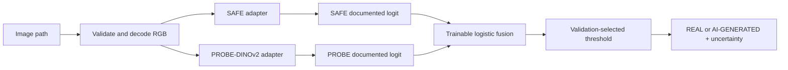

# SAFE + PROBE-DINOv2 AI-Generated Image Detector

Phase 1 is a reproducible, modular detector that combines the official
[SAFE](https://github.com/Ouxiang-Li/SAFE) checkpoint with the official
[PROBE-AIGI-Detection](https://github.com/Amamiya-C/PROBE-AIGI-Detection)
PROBE-DINOv2 checkpoint. The pretrained detectors remain frozen; only a
logistic-regression fusion layer is trained.

## Verification status

The upstream repositories were inspected on 2026-10-18:

* SAFE requires Python 3.9, PyTorch 2.2.1/torchvision 0.17.1, `timm`, and its
  repository dependencies. Its README documents `checkpoint/checkpoint-best.pth`
  and `scripts/eval.sh`, but the checkpoint file is not stored in the Git tree.
  The adapter therefore requires a local `SAFE_CHECKPOINT` path and imports the
  official `models.resnet.resnet50` implementation from a configured checkout.
* PROBE documents `Detector/evaluate_dino.py`, a 336-pixel crop, ImageNet
  normalization, and a scalar output from `model.dino_classifier`. The released
  checkpoint is hosted at the official ModelScope project. The adapter requires
  both `PROBE_REPO` and `PROBE_CHECKPOINT`; it never substitutes a generic
  DINOv2 classifier.
* No benchmark results are included in this repository. Reports are generated
  only after real data and both checkpoints are available.

## Setup

```powershell
python -m venv .venv
.\.venv\Scripts\Activate.ps1
pip install -r requirements.txt
git clone https://github.com/Ouxiang-Li/SAFE external/SAFE
git clone https://github.com/Amamiya-C/PROBE-AIGI-Detection external/PROBE-AIGI-Detection
```

Download the official checkpoints from the upstream release locations and set:

```powershell
$env:SAFE_REPO = "$PWD\external\SAFE"
$env:SAFE_CHECKPOINT = "$PWD\external\SAFE\checkpoint\checkpoint-best.pth"
$env:PROBE_REPO = "$PWD\external\PROBE-AIGI-Detection"
$env:PROBE_CHECKPOINT = "$PWD\checkpoints\DINOv2_best_model_step_34999.pth"
$env:PROBE_DINOV2_BACKBONE = "facebook/dinov2-with-registers-large"
```

The PROBE repository's classifier constructor defaults to an internal absolute
backbone path, so `PROBE_DINOV2_BACKBONE` must be set to the exact compatible
local DINOv2 backbone or an approved Hugging Face identifier. The checkpoint
and backbone must be compatible with the released state dictionary.

If any required path or backbone is missing, predictions fail explicitly with a checkpoint
configuration error. This is intentional: no mock or generic model is used.

## Inference

```python
from aiscan.inference.predictor import Predictor

result = Predictor.from_environment().predict_image("image.webp")
print(result.to_dict())
```

The result includes individual detector scores, the fused score, threshold,
uncertainty status, latency, and an explicit error status when inference cannot
run. Supported formats are JPG, JPEG, PNG, and WebP.

## Backend API

Install the API dependencies and start the server from the project directory:

```powershell
pip install -r requirements.txt
uvicorn aiscan.api.main:app --host 127.0.0.1 --port 8000
```

The API exposes `GET /`, `GET /health`, and `POST /predict`. Send the image as
the multipart field `file`:

```powershell
curl.exe -X POST http://127.0.0.1:8000/predict -F "file=@image.png"
```

The default CORS allow-list includes both `localhost` and `127.0.0.1` variants
for ports 3000 and 5173. Override it with a comma-separated `CORS_ORIGINS`
value; do not use `*` in production.
Uploads are decoded and verified with Pillow rather than trusting
the filename or MIME type. If checkpoints, dependencies, or the trained fusion
artifact are unavailable, `/health` reports `model_ready: false` and `/predict`
returns `status: "model_not_ready"` without claiming a prediction.

## React frontend

The Vite + React + TypeScript dashboard lives in `frontend/` and calls only
the backend API. Configure the backend URL in `frontend/.env`:

```powershell
cd frontend
Copy-Item .env.example .env
npm install
npm run dev
```

The default URL is `http://127.0.0.1:8000`; set `VITE_API_URL` for another
backend. For a production build, run `npm run build`. The frontend shows a
setup state when the backend reports missing model assets and never fabricates
scores or classifications.

## Fusion training and evaluation

The manifest format is CSV with `path,label,split,generator` columns, where
`label` is `0` for real and `1` for AI-generated. Keep generator identities
grouped across splits to prevent leakage.

```powershell
python -m aiscan.fusion.train --manifest data\manifest.csv --output artifacts\fusion.json
python -m aiscan.evaluation.evaluate --manifest data\manifest.csv --fusion artifacts\fusion.json --output artifacts\report.json
```

Fusion training caches detector logits, uses weighted binary cross-entropy and
L2 regularization, and selects a validation threshold by balanced accuracy.
The final test split is never used for fitting, calibration, or threshold
selection. `artifacts/` contains only generated reports and must not contain
checkpoints or datasets.

## Architecture



## Limitations

Scores are detector outputs and are not automatically calibrated probabilities.
The default fusion consumes documented AI-vs-real logits. Generalization to
unseen generators, compression, crops, blur, and screenshots must be measured
on a held-out dataset such as GenImage; this project does not fabricate those
measurements. Review upstream licenses and dataset terms before redistribution.
