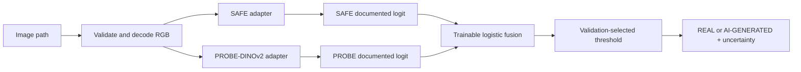

# SAFE + PROBE-DINOv2 AI-Generated Image Detector

Phase 1 is a reproducible, modular detector that combines the official
[SAFE](https://github.com/Ouxiang-Li/SAFE) checkpoint with the official
[PROBE-AIGI-Detection](https://github.com/Amamiya-C/PROBE-AIGI-Detection)
PROBE-DINOv2 checkpoint. The pretrained detectors remain frozen; only a
logistic-regression fusion layer is trained.

## Verification status

The upstream repositories were inspected on 2026-10-18:

* SAFE requires Python 3.9, PyTorch 2.2.1/torchvision 0.17.1, `timm`, and its
  repository dependencies. Its README documents `checkpoint/checkpoint-best.pth`
  and `scripts/eval.sh`, but the checkpoint file is not stored in the Git tree.
  The adapter therefore requires a local `SAFE_CHECKPOINT` path and imports the
  official `models.resnet.resnet50` implementation from a configured checkout.
* PROBE documents `Detector/evaluate_dino.py`, a 336-pixel crop, ImageNet
  normalization, and a scalar output from `model.dino_classifier`. The released
  checkpoint is hosted at the official ModelScope project. The adapter requires
  both `PROBE_REPO` and `PROBE_CHECKPOINT`; it never substitutes a generic
  DINOv2 classifier.
* No benchmark results are included in this repository. Reports are generated
  only after real data and both checkpoints are available.

## Setup

```powershell
python -m venv .venv
.\.venv\Scripts\Activate.ps1
pip install -r requirements.txt
git clone https://github.com/Ouxiang-Li/SAFE external/SAFE
git clone https://github.com/Amamiya-C/PROBE-AIGI-Detection external/PROBE-AIGI-Detection
```

Download the official checkpoints from the upstream release locations and set:

```powershell
$env:SAFE_REPO = "$PWD\external\SAFE"
$env:SAFE_CHECKPOINT = "$PWD\external\SAFE\checkpoint\checkpoint-best.pth"
$env:PROBE_REPO = "$PWD\external\PROBE-AIGI-Detection"
$env:PROBE_CHECKPOINT = "$PWD\checkpoints\DINOv2_best_model_step_34999.pth"
$env:PROBE_DINOV2_BACKBONE = "facebook/dinov2-with-registers-large"
```

The PROBE repository's classifier constructor defaults to an internal absolute
backbone path, so `PROBE_DINOV2_BACKBONE` must be set to the exact compatible
local DINOv2 backbone or an approved Hugging Face identifier. The checkpoint
and backbone must be compatible with the released state dictionary.

## Training a standalone deepfake classifier

The existing SAFE/PROBE fusion remains separate. To train a binary classifier
from a FaceForensics subset manifest, use `filepath`, `label_id` (`0 = real`,
`1 = fake`), and `source_video_ids` (`|`-separated IDs). The script validates
all files and labels, builds connected source-video groups, and stops if a
group leaks across splits. `original_path` is never read as a feature.

```powershell
python -m aiscan.training.train_classifier `
  --manifest "C:\Users\ADARSH\Downloads\faceforensics_subset\faceforensics_subset\dataset.csv" `
  --output "artifacts\deepfake_classifier" `
  --epochs 10 --patience 3 --seed 42 --cpu
```

The command downloads timm's pretrained Xception41 ImageNet weights if
they are not cached. It saves `best_model.pt`, `preprocessing.json`,
`training_log.json`, `splits.json`, and `evaluation.json` in the new output
directory. Validation loss controls early stopping; the test split is used
only once for final metrics.

If any required path or backbone is missing, predictions fail explicitly with a checkpoint
configuration error. This is intentional: no mock or generic model is used.

## Inference

```python
from aiscan.inference.predictor import Predictor

result = Predictor.from_environment().predict_image("image.webp")
print(result.to_dict())
```

The result includes individual detector scores, the fused score, threshold,
uncertainty status, latency, and an explicit error status when inference cannot
run. Supported formats are JPG, JPEG, PNG, and WebP.

## Backend API

Install the API dependencies and start the server from the project directory:

```powershell
pip install -r requirements.txt
uvicorn aiscan.api.main:app --host 127.0.0.1 --port 8000
```

The API exposes `GET /`, `GET /health`, and `POST /predict`. Send the image as
the multipart field `file`:

```powershell
curl.exe -X POST http://127.0.0.1:8000/predict -F "file=@image.png"
```

The default CORS allow-list includes both `localhost` and `127.0.0.1` variants
for ports 3000 and 5173. Override it with a comma-separated `CORS_ORIGINS`
value; do not use `*` in production.
Uploads are decoded and verified with Pillow rather than trusting
the filename or MIME type. If checkpoints, dependencies, or the trained fusion
artifact are unavailable, `/health` reports `model_ready: false` and `/predict`
returns `status: "model_not_ready"` without claiming a prediction.

## React frontend

The Vite + React + TypeScript dashboard lives in `frontend/` and calls only
the backend API. Configure the backend URL in `frontend/.env`:

```powershell
cd frontend
Copy-Item .env.example .env
npm install
npm run dev
```

The default URL is `http://127.0.0.1:8000`; set `VITE_API_URL` for another
backend. For a production build, run `npm run build`. The frontend shows a
setup state when the backend reports missing model assets and never fabricates
scores or classifications.

## Fusion training and evaluation

The fusion pipeline uses only real outputs from the frozen official SAFE and
PROBE-DINOv2 checkpoints. It requires `SAFE_REPO`, `SAFE_CHECKPOINT`,
`PROBE_REPO`, `PROBE_CHECKPOINT`, and `PROBE_DINOV2_BACKBONE`. The repository
checkout and checkpoints are not committed.

The manifest is CSV with required columns `path,label,split,generator`.
Relative paths are resolved relative to the manifest. Labels are `0` for
**real** and `1` for **AI-generated**. `split` must be `train`, `validation`,
or `test`. `generator` identifies the camera/source or image generator and is
required for leakage analysis. Images must exist and be decodable; invalid
labels, duplicate paths, and missing splits fail validation. Keep a generator
or source in one split only when creating the manifest.

Extract and cache detector logits:

```powershell
python -m aiscan.fusion.extract `
  --manifest data\manifest.csv `
  --output artifacts\scores.csv
```

The cache has one row per manifest image, including `status` and `error`;
failures are retained rather than skipped. `scores.metadata.json` records the
manifest hash, checkpoint hashes, backbone, feature names, and score
semantics. SAFE's feature is its class-1-minus-class-0 logit margin.
PROBE-DINOv2's feature is its scalar AI-vs-real logit averaged over official
336-pixel sliding patches. Unchanged metadata reuses the cache; use `--force`
to regenerate it.

Train the logistic fusion classifier:

```powershell
python -m aiscan.fusion.train `
  --manifest data\manifest.csv `
  --scores artifacts\scores.csv `
  --output artifacts\fusion.json `
  --seed 42
```

Only `train` rows fit the `StandardScaler` and scikit-learn
`LogisticRegression`. `validation` rows select the balanced-accuracy
threshold. `test` rows are never used during training or threshold selection.
The versioned JSON artifact contains the classifier, train-fitted scaling
parameters, threshold, seed, feature definitions, and leakage diagnostics.
Training fails if detector errors remain in train or validation rows.

Evaluate the held-out test split:

```powershell
python -m aiscan.evaluation.evaluate `
  --manifest data\manifest.csv `
  --scores artifacts\scores.csv `
  --fusion artifacts\fusion.json `
  --output artifacts\report.json
```

The report includes accuracy, precision, recall, F1, ROC-AUC, confusion
matrix, false-positive rate, individual SAFE and PROBE-DINOv2 metrics, fused
metrics, per-generator metrics, per-file-extension metrics, class counts,
duplicate-content checks, and generator/source split leakage. Compression or
degradation metrics are explicitly reported unavailable unless such columns
are added to the manifest and evaluated. No accuracy claim is made until this
command produces a real held-out report.

## Architecture



## Limitations

Scores are detector outputs and are not automatically calibrated probabilities.
The default fusion consumes documented AI-vs-real logits. Generalization to
unseen generators, compression, crops, blur, and screenshots must be measured
on a held-out dataset such as GenImage; this project does not fabricate those
measurements. Review upstream licenses and dataset terms before redistribution.
